# OOP2026
### Homework1
```java
public class hellowold {
	 public static void main(String []args){
		 int i , j; 
		 for(i=0; i<10; i++) {
			  for(j=0; j<=i; j++) {
			    System.out.print("#");
			  }
			  for(; j<=10; j++) {
			    System.out.print(" ");
			  }
			  System.out.println();
			}
		 for(i=0; i<=10; i++) {
			  for(j=0; j<=10-i; j++) {
			    System.out.print("#");
			  }
			  for(; j<=10; j++) {
			    System.out.print(" ");
			  }
			  System.out.println();
			}
		 for(i=0; i<10; i++) {
			  for(j=0; j<=10-i; j++) {
			    System.out.print(" ");
			  }
			  for(; j<=10; j++) {
			    System.out.print("#");
			  }
			  System.out.println();
			}
		 for(i=0; i<=10; i++) {
			  for(j=0; j<=i; j++) {
			    System.out.print(" ");
			  }
			  for(; j<=10; j++) {
			    System.out.print("#");
			  }
			  System.out.println();
			}
}
}
```
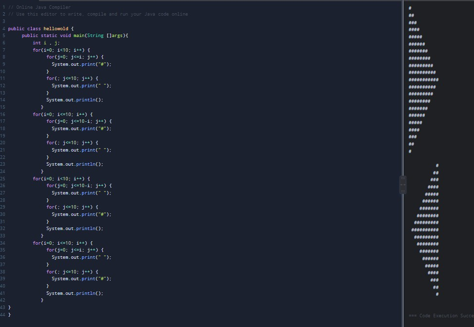

### Homework2
```java
public class Main {
    public static void main(String[] args) {
        int a = 1;
        int b = 1;
        for(int i=1; i<=20; i++) {
            System.out.print(a + " ");
            int next = a + b;
            a = b;
            b = next; 
        }
    }
}
```
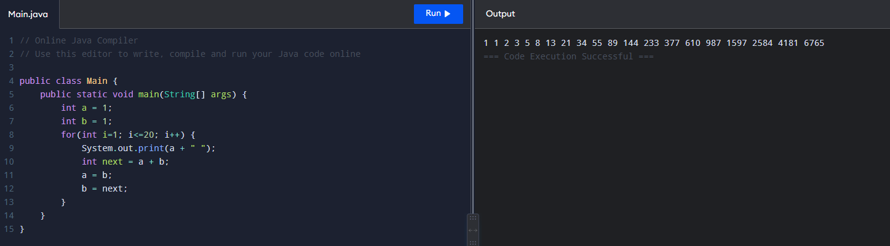

### Homework3
```java
public class Main {
    public static void main(String[] args) {
        int a = 1;
        int b = 2;
        for (int i = 1; i <= 20; i++) {
             System.out.println(b + "/" + a + " = " + (double)b / a);
            
            int temp = a + b;
            a = b;
            b = temp;
        }
    }
}
```
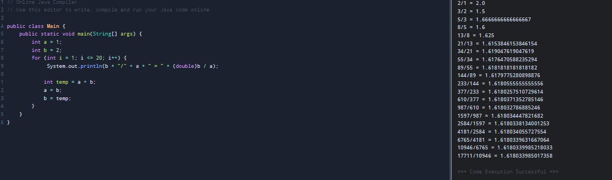

### Homework4
```java
public class Main {
    public static void main(String[] args) {
        for (int i = 1; i <= 9; i++) {
            for (int j = 1; j <=9; j++) {
                System.out.printf("%d*%d=%-2d\t", j, i, j * 1);
            }
            System.out.println();
        }
       
    }
}
```
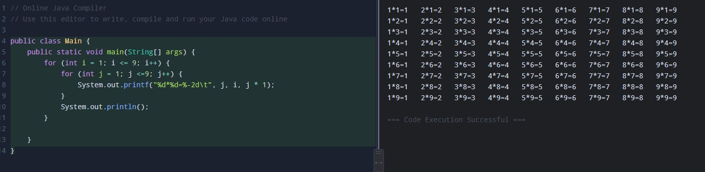

### Homework5
```java
public class Main {
    public static void main(String[] args) {
        double pi = 0;
        for (int i = 1; i <= 29; i += 2) {

            if (i == 1) {
                pi += 4.0 / i;
                System.out.print("pi = 4/" + i);
            } 
            else if ((i / 2) % 2 == 1) {
                pi -= 4.0 / i;
                System.out.print(" - 4/" + i);
            } 
            else {
                pi += 4.0 / i;
                System.out.print(" + 4/" + i);
            }
        }
    }
}
```
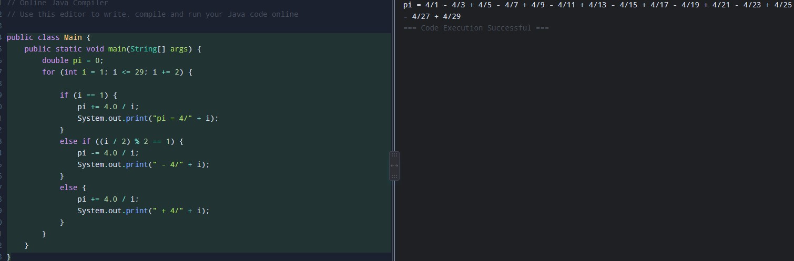

### Homework6
```java
public class Binomial {
    public static void main(String[] args) {
        int binomial[][] = new int[7][7];
        for (int i = 0; i < 7; i++) {
            binomial[i][0] = 1;
            binomial[i][i] = 1;

            for (int j = 1; j < i; j++) {
                binomial[i][j] =
                    binomial[i - 1][j - 1] + binomial[i - 1][j];
            }
        }
        for (int i = 0; i < 7; i++) {
            for (int j = 0; j <= i; j++) {
                System.out.print(binomial[i][j] + " ");
            }
            System.out.println();
        }
    }
}
```
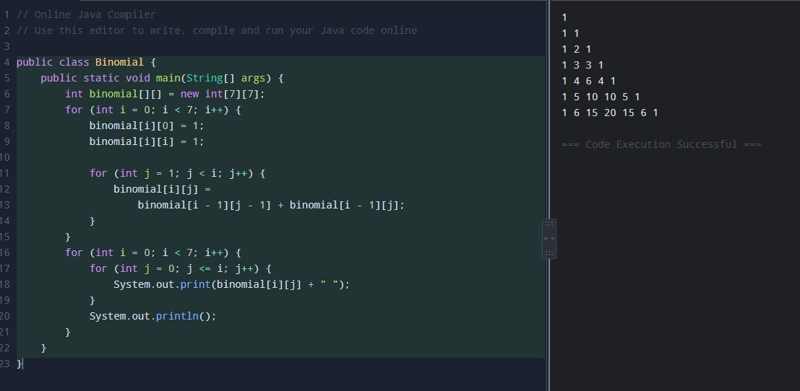

### Homework7
```java
public class SelectionSort {
    public static void main(String[] args) {
        int data[] = new int[20];
        for (int i = 0; i < 20; i++) {
            data[i] = (int)(Math.random() * 100);
        }
        for (int i = 0; i < 20; i++) {
            System.out.print(data[i] + " ");
        }
        for (int i = 0; i < 19; i++) {
            int min = i;
            for (int j = i + 1; j < 20; j++) {
                if (data[j] < data[min]) {
                    min = j;
                }
            }
            System.out.print("\n");
            int temp = data[i];
            data[i] = data[min];
            data[min] = temp;
        }
        for (int i = 0; i < 20; i++) {
            System.out.print(data[i] + " ");
        }
    }
}
```
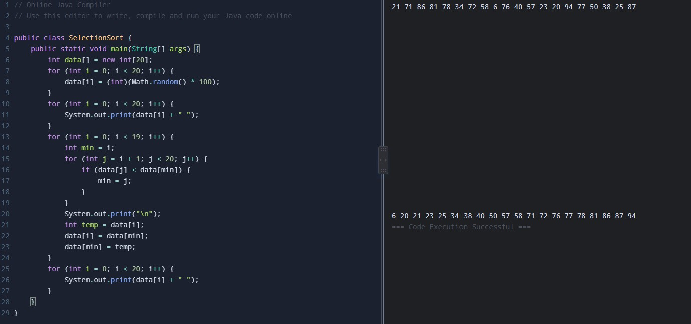

### Homework8
```java
public class Main {
    public static void main(String[] args) {
        int score[][] = new int[30][5];
        for (int i = 0; i < 30; i++) {
            for (int j = 0; j < 4; j++) {
                score[i][j] = (int)(Math.random() * 101);
            }
            score[i][4] = score[i][0] + score[i][1]
                        + score[i][2] + score[i][3];
        }
        for (int i = 0; i < 30; i++) {
            System.out.print((i + 1) + "\t");
            for (int j = 0; j < 5; j++) {
                System.out.print(score[i][j] + "\t");
            }
            System.out.println();
        }
    }
}
```
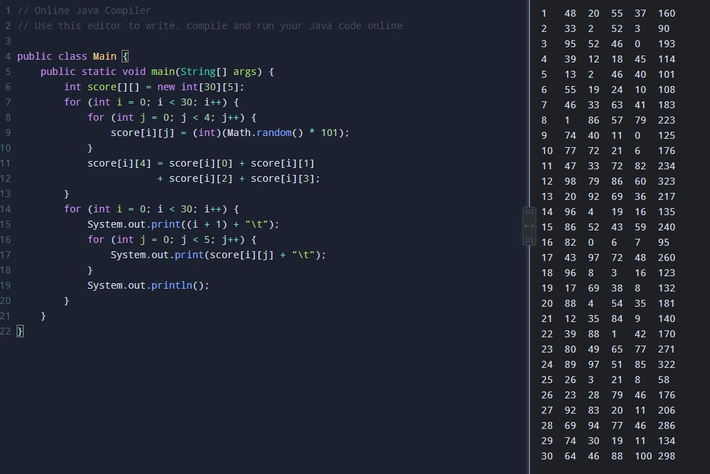

### Homework9
```
1.625 = 1.11  
1.562 = 1.101 
1.875 = 0.111 
0.875 = 0.111
13.875 = 1101.111
45.875 = 101101.111
1.9 = 1.1110011001100110011
1.1 = 1.0001100110011001101
```
### Homework10
```java
public class dosu {

	public static void main(String[] args) {
		// 스캐너 선언
				Scanner sc = new Scanner(System.in);
				
				// 변수 선언
				int array_count, max_value, bin_size, display_scale;
				int index, last_max;

				
				// 입력 부분
				System.out.print("랜덤 생성할 표본 수 : ");
				array_count = sc.nextInt();
				
				System.out.print("\n랜덤 생성할 표본의 최댓값 : ");
				max_value = sc.nextInt();
				
				System.out.print("\n구분할 범위 : ");
				bin_size = sc.nextInt();
				
				System.out.print("\n#의 대응비 : ");
				display_scale = sc.nextInt();
				
				while(display_scale <= 0) { // display_scale == 0 인경우 오류발생하므로 방지하기 위한 구문
					System.out.print("\n#의 대응비 : ");
					display_scale = sc.nextInt();
				}
				
				// 배열 선언
				int[] array_data = new int[array_count];
				int[] array_Dosu = new int[(max_value + bin_size - 1)/bin_size]; // (최댓값+범위값-1)/범위값 = 필요한 배열의 크기를 구하기 위한 올림나눗셈
				
				// 입력이 필요한 변수 추가선언
				int range = ( max_value / bin_size - 1 )/ bin_size; //
				
				// 생성된 변수의 구간을 계산, 구간에 추가시키는 반복분
				for (int i=0; i<array_data.length; i++) {
					array_data[i] = (int)(Math.random()*max_value); // 0~100까지의 랜덤변수 생성
					index = array_data[i] / bin_size; // 생성값/범위값의 정수 부분만 따져서 인덱스 결정
					array_Dosu[index]++; // 해당하는 인덱스 +1
				}
				
				
				for (int i = 0; i < (max_value + bin_size - 1)/ bin_size; i++) {
					if (i == ( (max_value + bin_size - 1) / bin_size) - 1 ){
						last_max = max_value;
					} else {
						last_max = bin_size * (i+1) -1;
					}
					System.out.printf("%2d ~ %-10d", 0 + bin_size * i, last_max); // 올림나눗셈으로 범위를 지정시킬 수 있도록 함.
					for (int j = 0; j < array_Dosu[i] / display_scale; j++) { // 대응비에 따라 # 갯수 변경
						System.out.print("#");
					}
					System.out.println();
				}
	}
}
```
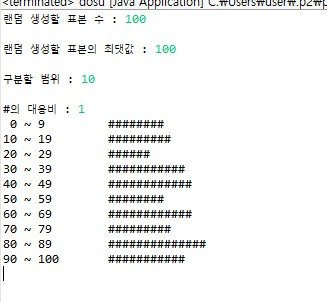

### Homework11
```java
public class mean {
	public static void main(String[] args) {
		// 스캐너 선언
				Scanner sc = new Scanner(System.in);
				// 변수 선언
				int array_count, change;
				double ari, geo, har, center;
				int value_count = 0;
				int geo_total = 1;
				double log_total = 0, har_total = 0, ari_total = 0;
				// 사용자 입력
				System.out.print("랜덤 생성할 변수 수 : ");
				array_count = sc.nextInt();
				while(array_count <= 0) {
					System.out.print("랜덤 생성할 변수 수 : ");
					array_count = sc.nextInt();
				}
				// 추가 변수 선언
				int[] array_data = new int[array_count];
				// 배열 랜덤값 생성
				for(int i = 0; i < array_count + 0; i++) {
					array_data[i] = (int)(Math.random()*100);
					System.out.printf("%3d ", array_data[i]);
					if( ( i + 1 ) % 25 == 0) {
						System.out.println();
					}
				}
				System.out.println();
				// 산술평균 반복문
				for(int i = 0; i < array_count; i++) {
					ari_total = ari_total + array_data[i];
				}
				ari = ari_total / array_data.length;
				System.out.printf("산술 평균 : %f\n", ari);
				// 기하평균 반복문
				for(int i = 0; i < array_count; i++) {
					if(array_data[i] != 0) {
						log_total += Math.log(array_data[i]);
						value_count += 1;
					}
				}
				geo = Math.exp(log_total/value_count);
				System.out.printf("기하 평균 : %f\n", geo);
				// 조화평균
				value_count = 0; // 사용한 변수 초기화
				for(int i = 0; i < array_count; i++) {
					if(array_data[i] != 0) {
						har_total = har_total + (1.0 / array_data[i]);
						value_count += 1;
					}
				}
				har = value_count / har_total;
				System.out.printf("조화 평균 : %f\n", har);
				// 중간값
				// 정렬 실시
				for (int i = 1; i < array_count; i++) {
					if (array_data[i-1] > array_data[i]) {
						change = array_data[i-1];
						array_data[i-1] = array_data[i];
						array_data[i] = change;
						i = 0;
					}
				}
				if(array_data.length % 2 == 0) {
					center = (array_data[array_data.length / 2 - 1] + array_data[(array_data.length / 2)]) / 2.0;
				} else {
					center = array_data[array_data.length / 2];
				}
				System.out.printf("종간값 : %f", center)
	}
}
```
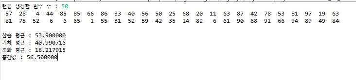

### Homework12
```
78  = 01001110
-78 = 10110010
```

### Homework13
```java
package miniCalculator;

import java.util.Scanner;

public class Calculator {
	public static void main(String[] args) {
		int i = 1;
		int reverse = 3;
		double result = 0;
		Scanner sc = new Scanner(System.in);
		String inputString = sc.nextLine();
		String[] inputArray = inputString.split(" ");
		
		for (String a : inputArray) {
			System.out.println(a);
		}
		
		if (reverse < inputArray.length) {
			i = ((inputArray[1].equals("+") || inputArray[1].equals("-")) && 
			     (inputArray[3].equals("#") || inputArray[3].equals("/"))) ? 3 : 1;
		}
		
		switch (inputArray[i]) {
			case "+" -> result = F_plus(Double.parseDouble(inputArray[i - 1]), Double.parseDouble(inputArray[i + 1]));
			case "-" -> result = F_minus(Double.parseDouble(inputArray[i - 1]), Double.parseDouble(inputArray[i + 1]));
			case "#" -> result = F_multi(Double.parseDouble(inputArray[i - 1]), Double.parseDouble(inputArray[i + 1]));
			case "/" -> result = F_divi(Double.parseDouble(inputArray[i - 1]), Double.parseDouble(inputArray[i + 1]));
		}
		
		if (reverse < inputArray.length) {
			if (i == 3) {
				i = 1;
				switch (inputArray[i]) {
					case "+" -> result = F_plus(Double.parseDouble(inputArray[i - 1]), result);
					case "-" -> result = F_minus(Double.parseDouble(inputArray[i - 1]), result);
					case "#" -> result = F_multi(Double.parseDouble(inputArray[i - 1]), result);
					case "/" -> result = F_divi(Double.parseDouble(inputArray[i - 1]), result);
				}
			} else {
				i = 3;
				switch (inputArray[i]) {
					case "+" -> result = F_plus(result, Double.parseDouble(inputArray[i + 1]));
					case "-" -> result = F_minus(result, Double.parseDouble(inputArray[i + 1]));
					case "#" -> result = F_multi(result, Double.parseDouble(inputArray[i + 1]));
					case "/" -> result = F_divi(result, Double.parseDouble(inputArray[i + 1]));
				}
			}
		}
		sc.close();
	}

	public static double F_plus(double a, double b) {
		double out = a + b;
		System.out.printf("%f\n", out);
		return out;
	}
	
	public static double F_minus(double a, double b) {
		double out = a - b;
		System.out.printf("%f\n", out);
		return out;
	}
		
	public static double F_multi(double a, double b) {
		double out = a * b;
		System.out.printf("%f\n", out);
		return out;
	}
	
	public static double F_divi(double a, double b) {
		double out = a / b;
		System.out.printf("%f\n", out);
		return out;
	}
}
```
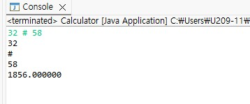
